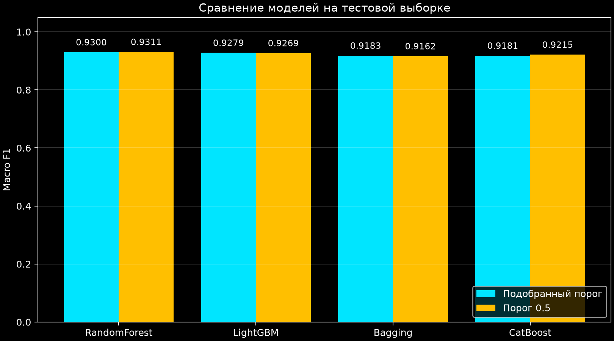
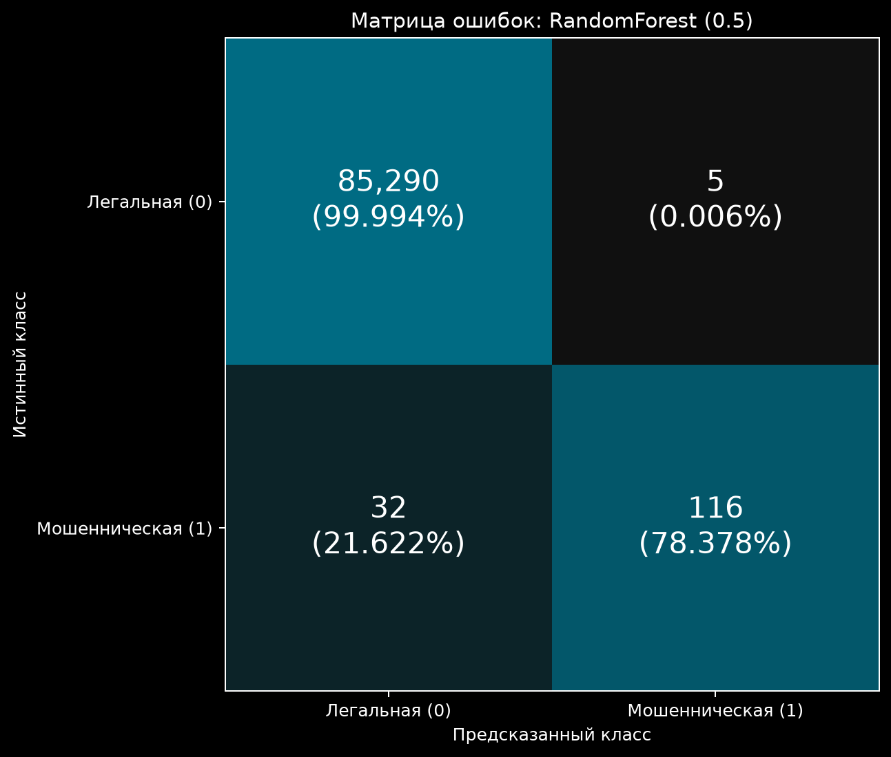

# Лабораторная №5. Как программа распознаёт мошеннические транзакции

Программа читает таблицу банковских операций, учится на операциях с известным результатом и проверяет себя на отложенных строках. Она сравнивает четыре метода, подбирает настройки и строит таблицу ошибок. **Реальные платежи программа не блокирует**: ниже «блокировка» — предполагаемое действие при ответе «мошенничество».

Задание требует сравнивать методы по **macro F1**. Сначала объясним эту оценку и её ограничения, затем модели и код всех пяти файлов. Открывать исходники отдельно для чтения разбора не нужно: код приведён прямо здесь.

## 1. Что находится в данных

Источник: [Credit Card Fraud Detection на Kaggle](https://www.kaggle.com/datasets/mlg-ulb/creditcardfraud). Одна строка `creditcard.csv` — одна операция. **Признак** — число, описывающее операцию. **Класс** — известный правильный ответ.

| Столбец | Значение | Роль |
|---|---|---|
| `Time` | Секунды от первой операции в наборе | Входной признак |
| `V1`–`V28` | Числовые признаки, преобразованные авторами для сокрытия исходных данных; их бытовой смысл не раскрыт | Входные признаки |
| `Amount` | Сумма операции, не количество операций | Входной признак |
| `Class` | 0 — обычная операция, 1 — мошенническая | Правильный ответ |

Всего 284 807 операций: 284 315 обычных и 492 мошеннических. Мошенничества около 0,173%. Это **дисбаланс классов**: один вид встречается значительно реже другого.

Программа по 30 признакам должна предсказать `Class`. Сам `Class` удаляется из входных признаков: иначе правильный ответ уже был бы подан на вход.

## 2. Какие ошибки возможны и что измеряют метрики

**Метрика** — число, которым оценивают качество ответов. Сначала нужны четыре количества. Здесь «положительный ответ» всегда означает «мошенничество», то есть класс 1.

| Обозначение | Что произошло | Практический смысл |
|---|---|---|
| `TP` — true positive | Мошенничество распознано | Верная тревога |
| `FP` — false positive | Обычная операция названа мошеннической | Ложная тревога, возможная ошибочная блокировка клиента |
| `FN` — false negative | Мошенничество названо обычной операцией | Пропущенное мошенничество |
| `TN` — true negative | Обычная операция распознана | Правильное разрешение операции |

**Матрица ошибок** — эти четыре числа в таблице. У лучшего варианта нашего запуска она такая:

| Истинный класс ↓ / Ответ программы → | Обычная, 0 | Мошенническая, 1 |
|---|---:|---:|
| Обычная, 0 | TN = 85 290 | FP = 5 |
| Мошенническая, 1 | FN = 32 | TP = 116 |

### Precision, recall, FPR и accuracy

У всех четырёх показателей диапазон [0; 1]. Например, 0,95 соответствует 95%. Но они отвечают на разные вопросы.

| Показатель | Вопрос | Расчёт для нашей матрицы |
|---|---|---|
| **Precision класса 1**, точность тревог | Из всех операций, названных мошенническими, сколько действительно мошеннические? | `TP / (TP + FP)` = 116 / 121 = **95,87%** |
| **Recall класса 1**, полнота обнаружения | Из всех настоящих мошенничеств сколько нашли? | `TP / (TP + FN)` = 116 / 148 = **78,38%** |
| **FPR**, доля ложных тревог | Какую долю обычных операций ошибочно пометили? | `FP / (FP + TN)` = 5 / 85 295 ≈ **0,00586%** |
| **Accuracy**, доля всех правильных ответов | Сколько ответов правильные среди всех операций? | `(TP + TN) / все операции` = 85 406 / 85 443 ≈ **99,9567%** |

Для precision, recall и accuracy больше — лучше; для FPR меньше — лучше. Precision и FPR используют разные знаменатели: в нашем случае **5 ложных тревог из 121 тревоги**, но **5 из 85 295 обычных операций**.

Одна accuracy здесь обманчива: если на всём наборе всегда отвечать «обычная», получится около 99,827%, но ни одного найденного мошенничества. Precision тоже недостаточно: можно выдать одну верную тревогу, получить 100% precision и пропустить почти всё остальное.

Определения: [precision](https://scikit-learn.org/stable/modules/generated/sklearn.metrics.precision_score.html), [recall](https://scikit-learn.org/stable/modules/generated/sklearn.metrics.recall_score.html).

### F1 и macro F1

**F1 класса 1** объединяет точность тревог и полноту обнаружения:

```text
F1 = 2 × precision × recall / (precision + recall)
   = 2 × TP / (2 × TP + FP + FN)
```

Это гармоническое среднее: высокая точность не скрывает низкую полноту и наоборот. Диапазон [0; 1], больше — лучше. При отсутствии ошибок F1 = 1; если верных положительных ответов нет, F1 = 0. При нулевом знаменателе настройка `zero_division=0` в отчёте задаёт результат 0.

Для мошенничества получаем `232 / (232 + 5 + 32)` = **0,862454**. Формула штрафует оба вида ошибок, но не задаёт их денежную стоимость.

Можно аналогично посчитать **F1 класса 0**, временно считая искомым ответом обычную операцию. Он равен **0,999783**.

**Macro F1** сначала считает F1 отдельно для каждого класса, затем берёт простое среднее:

```text
macro F1 = (F1 обычных + F1 мошеннических) / 2
         = (0,999783 + 0,862454) / 2
         ≈ 0,931118
```

Слово `macro` означает, что **каждая оценка класса имеет одинаковый вес**. Так многочисленные обычные операции не могут полностью скрыть плохое обнаружение редкого мошенничества. **0,931118 не означает «нашли 93,1% мошенничеств»**: нашли 78,38%.

Macro F1 также лежит в [0; 1], больше — лучше. Она не учитывает сумму операции, ущерб от задержки платежа и допустимое число ложных блокировок. [Документация F1 и усреднения](https://scikit-learn.org/stable/modules/generated/sklearn.metrics.f1_score.html).

### Почему равные веса не означают одинаковую цену ошибок

**Равные веса двух F1 взяты из условия лабораторной: оно требует macro F1. Это не утверждение, что пропуск мошенничества и блокировка обычного клиента равноценны.** В прежнем README это различие не было объяснено.

Твой приоритет — уверенно отмечать мошенничество и избегать ложных блокировок обычных клиентов. Поэтому важны **precision класса 1**, число **FP** и **FPR**, но вместе с recall: иначе программа может почти перестать выдавать тревоги.

Для прикладной настройки можно задать: «найти максимум мошеннических операций при ограничении числа ложных тревог» или «максимизировать recall при precision не ниже согласованного уровня». Этот предел должен задать заказчик; из условия лабораторной он неизвестен. Другой вариант — **F0.5**: показатель, придающий precision большее значение, чем recall, но не гарантирующий заданный предел ложных блокировок. [Определение F-beta](https://scikit-learn.org/stable/modules/generated/sklearn.metrics.fbeta_score.html).

**Текущий код решает учебную задачу по macro F1. Ограничения на ложные блокировки в нём пока нет.** Настройка `class_weight` меняет обучение, но сама не вводит такое ограничение и не задаёт стоимость ошибок.

## 3. Как оценка модели превращается в ответ

Модель выдаёт `p` от 0 до 1 — свою оценку вероятности мошенничества. Это не доказательство: число 0,8 не гарантирует, что ровно 80% таких операций окажутся мошенническими.

**Порог** — число, с которым сравнивают оценку:

```python
prediction = (probabilities >= cutoff).astype(int)
```

`probabilities` — оценки всех операций, `cutoff` — порог. Сравнение даёт `True`/`False`, `.astype(int)` превращает их в 1/0. При пороге 0,5 оценки `[0.1, 0.6, 0.9]` дадут ответы `[0, 1, 1]`; при пороге 0,8 — `[0, 0, 1]`.

На одном наборе повышение порога не увеличивает число тревог: FP и TP могут уменьшиться, FN — увеличиться. Так можно сократить ложные тревоги ценой пропущенных мошенничеств. Precision при этом **не обязан расти на каждом шаге**: важно, какие именно операции исчезнут из списка тревог.

В программе порог выбирается по максимуму macro F1 на валидации — проверочной части тренировочных данных. Порог 0,5 дополнительно оставлен для сравнения.

## 4. Что за модели и как они работают

**Модель** — правило, которое получает признаки и выдаёт оценку `p`. **Обучение** — построение этого правила по примерам с известным `Class`. Все четыре метода здесь используют деревья решений, не нейронные сети.

### Дерево решений — основа всех четырёх методов

Дерево задаёт вопросы вида «значение признака меньше границы?». Например, условный вопрос `V14 < -2` делит строки на две группы. Следующие вопросы уточняют группы. Признаки и границы выбираются при обучении; `-2` здесь только пример, а не извлечённое правило нашей модели.

Конечная группа называется **листом**. У обычного дерева классификации доля мошеннических примеров в листе определяет оценку вероятности; при весах классов учитываются взвешенные количества. **Глубина** — максимальное число последовательных разделений от начала до листа.

Очень глубокое дерево может запомнить случайные особенности обучающих строк и хуже работать на новых. Это **переобучение**. Слишком простое дерево может не уловить закономерности. Поэтому сложность подбирается на отдельных проверочных данных.

### Бэггинг

`BaggingClassifier` обучает 30 деревьев на разных случайных наборах строк, затем усредняет их оценки вероятностей. Строки выбираются **с возвращением**: одна строка может попасть в набор несколько раз. Разные деревья ошибаются по-разному, и усреднение может сделать ответ устойчивее.

`max_samples=0.3` означает: для **каждого дерева** выбирается набор размером 30% переданных на обучение строк. Это не удаление 70% данных из всего эксперимента: у каждого дерева своя выборка. И это не тот же параметр, что `test_size=0.3` при отделении теста.

### Случайный лес

`RandomForestClassifier` тоже обучает деревья на случайных выборках с возвращением. Дополнительно при каждом разделении рассматривает случайную часть признаков. Здесь стандартная настройка `max_features="sqrt"` означает примерно квадратный корень из их числа: при 30 признаках обычно рассматриваются 5 кандидатов на разделение.

Так деревья меньше повторяют друг друга. В коде их 150, итоговая оценка — среднее вероятностей. У дерева нашего бэггинга при разделении доступны все признаки; это основное отличие от леса в этой реализации.

### LightGBM

LightGBM использует **градиентный бустинг**: деревья добавляются последовательно и изменяют текущие оценки в сторону уменьшения функции ошибки. **Функция ошибки** — численная мера расхождения оценок с правильными ответами при обучении. В этой бинарной классификации применяется логистическая ошибка: уверенный неправильный ответ штрафуется сильнее осторожного.

LightGBM ускоряет поиск разделений, группируя числовые значения в интервалы. Дерево обычно расширяется через лист, разделение которого сильнее уменьшает ошибку. Поэтому `num_leaves`, максимум листьев, ограничивает сложность модели.

В коде 400 шагов. `learning_rate=0.05` уменьшает вклад каждого нового дерева: это размер шага изменения оценки, а не обещание улучшить качество на 5%.

### CatBoost

CatBoost тоже использует бустинг. В применяемом стандартном режиме он строит симметричные деревья: на одном уровне ко всем узлам применяется одно условие разделения. При глубине 6 возможно до 64 листьев.

CatBoost умеет специально обрабатывать категориальные признаки, например названия городов. Но здесь все признаки уже числовые, поэтому эта возможность не используется. Мы сравниваем его работу с числовыми данными.

В коде 500 шагов и `learning_rate=0.05`. Во время обучения уменьшается `Logloss`, а при выборе настроек сравнивается macro F1. **Функция обучения и метрика выбора модели могут различаться.**

## 5. Что означает «оптимизировать» и какие параметры меняются

Границы вопросов внутри деревьев модель находит при обучении. А **гиперпараметры** задаются до обучения: число деревьев, допустимая глубина и т. п. В коде слово `parameters` обозначает именно настройки.

**Сетка параметров** — заранее выбранные значения для проверки. Программа обучает модели с их сочетаниями и сравнивает результаты. Это небольшой поиск, а не доказательство глобального максимума среди любых возможных методов.

| Параметр | Значения | Смысл и влияние |
|---|---|---|
| `n_estimators` | Бэггинг 30, лес 150, LightGBM 400; фиксированы | Число деревьев; больше требует больше времени, у бустинга это ещё и число последовательных шагов |
| `iterations` | CatBoost 500; фиксировано | Число шагов бустинга |
| `max_samples` | Бэггинг 0.3; фиксировано | Размер выборки для одного дерева |
| `estimator__max_depth` | Бэггинг 8 или 16 | Глубина вложенного дерева; `__` позволяет настроить модель внутри ансамбля |
| `max_depth` | Лес 12 или `None` | `None` — глубина не ограничена этим параметром; другие условия остановки остаются |
| `class_weight` | `None` или вариант `balanced` | `None` — равный исходный вес строк. `balanced` повышает вес редкого класса обратно пропорционально частоте; может улучшить поиск мошенничества, но увеличить ложные тревоги |
| `balanced_subsample` | Вариант веса для леса | Вычисляет веса по выборке каждого дерева |
| `num_leaves` | LightGBM 15 или 31 | Максимум листьев: больше — сложнее зависимость, которую можно описать, но выше риск переобучения |
| `reg_lambda` | LightGBM 1 или 5 | L2-регуляризация — штраф за большие значения в листьях; больший штраф сильнее сдерживает изменения |
| `depth` | CatBoost 5 или 7, базово 6 | Глубина симметричных деревьев |
| `l2_leaf_reg` | CatBoost 3 или 10 | Сила L2-регуляризации значений листьев |
| `learning_rate` | 0.05 у двух бустингов; фиксировано | Вклад нового дерева; меньший шаг обычно требует больше деревьев |
| `threshold` / `cutoff` | Ищется по валидационным оценкам | Граница ответа 0/1, применяется после обучения |

У каждой модели два параметра по два значения: `2 × 2 = 4` сочетания. Дополнительно проверяется базовый вариант без изменения настроек. У леса одно сочетание совпадает с базовым и нового кандидата не добавляет. Затем выбранный вариант ещё раз учится на всех тренировочных данных. Всего **24 вызова обучения ансамблей**: `4 × (5 проверок + 1 итоговое обучение)`.

Служебные параметры:

| Параметр | Назначение |
|---|---|
| `random_state=42`, `random_seed=42` | Фиксируют источник случайности для повторения опыта в том же окружении; 42 не является «лучшим» числом |
| `n_jobs=4`, `thread_count=4` | До четырёх рабочих потоков/процессов в зависимости от библиотеки |
| `verbosity=-1`, `verbose=False` | Отключают подробный вывод библиотек |
| `deterministic=True`, `force_col_wise=True` | Настройки LightGBM для воспроизводимого CPU-расчёта с обработкой по столбцам |
| `allow_writing_files=False` | CatBoost не создаёт дополнительные служебные файлы |

## 6. Зачем два раза разделять данные

Обучение и проверка на одних строках могут принять запоминание за качество. Поэтому части разделены:

| Часть | Всего | Мошеннических | Назначение |
|---|---:|---:|---|
| Весь набор | 284 807 | 492 | Исходная таблица |
| Тренировочные 70% | 199 364 | 344 | Всё, что можно использовать для обучения и настройки |
| Из них: обучение кандидатов | 149 523 | 258 | Построение деревьев во время перебора |
| Из них: валидация | 49 841 | 86 | Выбор настроек и порога |
| Итоговый тест, 30% | 85 443 | 148 | Сравнение готовых вариантов |

**Валидация** — проверка при выборе настроек. **Тест** — отдельная итоговая проверка. 25% валидации берутся **от тренировочных 70%**, а не от всего набора. После выбора настроек модель заново учится на всех 199 364 тренировочных строках, включая бывшую валидацию.

`stratify` сохраняет доли классов с точностью до целых строк. Иначе при случайном разделении редких мошеннических примеров в проверочной части могло бы оказаться слишком мало.

Настройки и подобранные пороги выбираются на валидации. В конце по условию лабораторной сравниваются восемь тестовых оценок: четыре модели с подобранными порогами и с заранее заданным 0,5. **Итоговый победитель выбирается по тесту.** Поэтому его результат — сравнение на данном тесте, а не независимая проверка всего процесса выбора. Для такой независимой оценки нужен ещё один нетронутый набор.

## 7. Код чтения данных — `data.py`

Во всех файлах `x` — таблица признаков, `y` — правильные классы. Окончания `fit`, `valid`, `train`, `test` указывают на части из таблицы выше. `import` подключает библиотеку, `def` объявляет функцию, `return` возвращает результат.

```python
from pathlib import Path

import numpy as np
import pandas as pd
from sklearn.model_selection import train_test_split


ROOT = Path(__file__).resolve().parent
SEED = 42


def load_data(path=ROOT / "creditcard.csv"):
    """Проверяет структуру данных и выделяет 30% для итогового теста."""
    df = pd.read_csv(path)
    columns = ["Time", *[f"V{i}" for i in range(1, 29)], "Amount", "Class"]
    if set(df.columns) != set(columns):
        raise ValueError("Ожидаются столбцы Time, V1–V28, Amount, Class.")
    if not np.isfinite(df.to_numpy(dtype=float)).all():
        raise ValueError("В данных есть пропуски или бесконечные значения.")
    if set(df.Class.unique()) != {0, 1}:
        raise ValueError("Class должен содержать классы 0 и 1.")
    return train_test_split(
        df.drop(columns="Class"), df.Class,
        test_size=0.3, stratify=df.Class, random_state=SEED,
    )
```

| Строка/выражение | Разбор |
|---|---|
| `from pathlib import Path` | Подключает инструмент работы с путями |
| `import numpy as np`, `import pandas as pd` | Подключает вычисления над массивами и работу с таблицами; `np` и `pd` — сокращённые имена |
| `from sklearn... import train_test_split` | Подключает разделение таблицы и ответов на согласованные части |
| `ROOT = Path(__file__).resolve().parent` | Находит папку текущего файла; CSV ищется рядом с ним, независимо от папки запуска |
| `SEED = 42` | Общее число для воспроизводимого случайного выбора |
| `def load_data(path=ROOT / "creditcard.csv")` | Объявляет функцию; `/` соединяет папку с именем файла, это путь по умолчанию |
| Текст в тройных кавычках | Описание функции для читателя, не исполняемая команда |
| `df = pd.read_csv(path)` | Читает CSV в DataFrame — таблицу pandas |
| `range(1, 29)` и `f"V{i}"` | Создают V1, V2, …, V28; верхняя граница 29 не входит |
| `*[...]` внутри списка `columns` | Вставляет эти имена в общий список ожидаемых столбцов |
| `set(df.columns) != set(columns)` | Сравнивает наборы имён без требования к их порядку |
| `raise ValueError(...)` | Останавливает программу с объяснением неподходящих данных |
| `df.to_numpy(dtype=float)` | Переводит таблицу в числовой массив |
| `np.isfinite(...).all()` | Проверяет, что все числа конечны: нет пропусков и бесконечностей; `not` обращает проверку |
| `df.Class.unique()` | Получает различные классы; ожидаются именно 0 и 1 |
| `df.drop(columns="Class")` | Создаёт таблицу входных признаков без правильного ответа |
| `df.Class` | Отдельно передаёт правильные ответы |
| `test_size=0.3` | Откладывает 30% строк в тест |
| `stratify=df.Class` | Сохраняет соотношение классов |
| `random_state=SEED` | Позволяет повторить разделение |

Порядок четырёх возвращённых объектов: `x_train, x_test, y_train, y_test`. Признаки не нормируются: этим деревьям не требуется приводить столбцы к общему масштабу.

## 8. Код создания моделей — `models.py`

```python
from catboost import CatBoostClassifier
from lightgbm import LGBMClassifier
from sklearn.ensemble import BaggingClassifier, RandomForestClassifier
from sklearn.tree import DecisionTreeClassifier

from data import SEED


def get_models():
    """Базовые модели и небольшие сетки параметров для локального CPU."""
    return {
        "Bagging": (
            BaggingClassifier(
                estimator=DecisionTreeClassifier(random_state=SEED),
                n_estimators=30, max_samples=0.3, n_jobs=4, random_state=SEED,
            ),
            {"estimator__max_depth": [8, 16],
             "estimator__class_weight": [None, "balanced"]},
        ),
        "RandomForest": (
            RandomForestClassifier(n_estimators=150, n_jobs=4, random_state=SEED),
            {"max_depth": [12, None], "class_weight": [None, "balanced_subsample"]},
        ),
        "LightGBM": (
            LGBMClassifier(
                n_estimators=400, learning_rate=0.05, verbosity=-1,
                n_jobs=4, random_state=SEED, deterministic=True, force_col_wise=True,
            ),
            {"num_leaves": [15, 31], "reg_lambda": [1, 5]},
        ),
        "CatBoost": (
            CatBoostClassifier(
                iterations=500, learning_rate=0.05, depth=6,
                loss_function="Logloss", verbose=False, allow_writing_files=False,
                thread_count=4, random_seed=SEED,
            ),
            {"depth": [5, 7], "l2_leaf_reg": [3, 10]},
        ),
    }
```

Импорты получают готовые реализации из CatBoost, LightGBM и sklearn. `DecisionTreeClassifier` — обычное дерево для бэггинга. `from data import SEED` использует ту же константу случайности.

`get_models()` возвращает **словарь**: по имени метода можно получить пару `(модель, сетка настроек)`. Фигурные скобки задают словарь, круглые скобки вокруг двух элементов — пару, квадратные — список допустимых значений.

`RandomForestClassifier(...)` и аналогичные строки только создают объекты с настройками — обучение ещё не начинается. Для обучения позже вызывается `.fit(...)`. `estimator=DecisionTreeClassifier(...)` сообщает бэггингу, какие модели объединять. **Ансамбль** — несколько моделей, работающих вместе. `estimator__max_depth` настраивает глубину именно вложенного дерева. Все аргументы этих конструкторов объяснены в разделах 4–5.

## 9. Код подбора настроек — `training.py`

```python
import numpy as np
import pandas as pd
from sklearn.base import clone
from sklearn.metrics import f1_score
from sklearn.model_selection import ParameterGrid


def best_threshold(y, probabilities):
    """Считает macro F1 для всех различных порогов без повторного обучения."""
    order = np.argsort(-probabilities, kind="stable")
    probabilities = probabilities[order]
    y = np.asarray(y)[order]
    # При одинаковой вероятности весь блок получает один класс.
    ends = np.r_[np.flatnonzero(np.diff(probabilities)), len(y) - 1]
    tp = np.cumsum(y)[ends]
    fp = ends + 1 - tp
    fn = y.sum() - tp
    tn = len(y) - y.sum() - fp
    scores = tp / (2 * tp + fp + fn) + tn / (2 * tn + fp + fn)
    best = int(np.argmax(scores))
    all_negative = (len(y) - y.sum()) / (2 * len(y) - y.sum())
    if all_negative > scores[best]:
        return float(np.nextafter(probabilities[0], np.inf)), float(all_negative)
    return float(probabilities[ends[best]]), float(scores[best])


def tune_model(model, grid, x_fit, y_fit, x_valid, y_valid):
    """Подбирает параметры и порог исключительно на валидационной выборке."""
    rows = []
    best_score = -1
    best_model = None
    best_cutoff = 0.5
    for params in [{}, *ParameterGrid(grid)]:
        candidate = clone(model).set_params(**params)
        candidate.fit(x_fit, y_fit)
        probabilities = candidate.predict_proba(x_valid)[:, 1]
        cutoff, score = best_threshold(y_valid, probabilities)
        rows.append({
            "parameters": params, "threshold": cutoff, "valid_macro_f1": score,
            "valid_macro_f1_at_0.5": f1_score(
                y_valid, probabilities >= 0.5, average="macro", zero_division=0,
            ),
        })
        if score > best_score:
            best_score, best_model, best_cutoff = score, clone(candidate), cutoff
    return best_model, best_cutoff, pd.DataFrame(rows)
```

Импорты: NumPy считает массивы, pandas собирает таблицу, `f1_score` вычисляет метрику, `ParameterGrid` перебирает сочетания, `clone` создаёт необученную копию модели.

### Функция `best_threshold`: проверка порогов

Ответы меняются, только когда порог пересекает одну из оценок модели. Поэтому достаточно проверить разные оценки и вариант «не выдать ни одной тревоги».

| Строка/выражение | Разбор |
|---|---|
| `np.argsort(-probabilities, kind="stable")` | Получает номера строк от большей оценки к меньшей. Минус меняет направление; `stable` сохраняет порядок равных оценок |
| `probabilities = probabilities[order]` | Переставляет оценки в этот порядок |
| `y = np.asarray(y)[order]` | Переставляет правильные ответы точно так же, чтобы пары не разошлись |
| `np.diff(probabilities)` | Вычисляет разности соседних оценок; ненулевая разность означает границу группы |
| `np.flatnonzero(...)` | Возвращает позиции ненулевых разностей |
| `np.r_[..., len(y) - 1]` | Добавляет последнюю позицию; получаются концы групп равных оценок. Одинаковые оценки при одном пороге нельзя разделить |
| `tp = np.cumsum(y)[ends]` | Считает накопленные единицы к каждой границе: сколько настоящих мошенничеств вошло в тревоги |
| `fp = ends + 1 - tp` | Все тревоги минус настоящие мошенничества = ложные тревоги |
| `fn = y.sum() - tp` | Все мошенничества минус найденные = пропуски |
| `tn = len(y) - y.sum() - fp` | Все обычные операции минус ложные тревоги = правильно разрешённые |
| `scores = ...` | Считает macro F1 для всех порогов. Двойки в числителях двух F1 сокращаются с делением среднего на 2 |
| `best = int(np.argmax(scores))` | Находит позицию максимума. При равенстве берёт первую, то есть более высокий порог среди этих кандидатов |
| `all_negative = ...` | Macro F1 случая «всё обычное»: F1 мошенничества равен нулю |
| `if all_negative > scores[best]` | Проверяет, не оказался ли этот крайний вариант лучше |
| `np.nextafter(probabilities[0], np.inf)` | Берёт ближайшее представимое число выше максимальной оценки: тревог не будет |
| `return float(...), float(...)` | Возвращает порог и его оценку как два обычных числа Python |

`tp`, `fp`, `fn`, `tn` здесь **массивы**, по одному значению на порог. Поэтому не приходится заново проходить все строки ради каждого порога.

Пример: после сортировки оценки `[0.9, 0.8, 0.8, 0.1]`, истинные классы `[1, 0, 1, 0]`.

| Порог | TP | FP | FN | TN | Кого пометили |
|---|---:|---:|---:|---:|---|
| Выше 0.9 | 0 | 0 | 2 | 2 | Никого |
| 0.9 | 1 | 0 | 1 | 2 | Первую операцию |
| 0.8 | 2 | 1 | 0 | 1 | Первые три: обе оценки 0.8 включаются вместе |
| 0.1 | 2 | 2 | 0 | 0 | Всех |

### Функция `tune_model`: сравнение настроек

| Строка/выражение | Разбор |
|---|---|
| `rows = []` | Список результатов всех проверок |
| `best_score = -1` | Начальная оценка ниже любой F1; первый вариант станет текущим лучшим |
| `best_model = None`, `best_cutoff = 0.5` | Начальные значения, пока лучший вариант не найден |
| `ParameterGrid(grid)` | Из двух глубин и двух весов создаёт четыре словаря сочетаний |
| `[{}, *ParameterGrid(grid)]` | Сначала пустой словарь — базовая модель без изменения настроек; затем сочетания сетки |
| `clone(model)` | Необученная копия модели с теми же настройками |
| `.set_params(**params)` | Передаёт словарь как именованные аргументы: например, `{"depth": 5}` становится `depth=5` |
| `candidate.fit(x_fit, y_fit)` | Строит деревья по обучающим признакам и правильным классам |
| `candidate.predict_proba(x_valid)` | Возвращает для каждой проверочной строки две оценки: класса 0 и класса 1 |
| `[:, 1]` | Берёт все строки и второй столбец — вероятность класса 1; нумерация начинается с нуля |
| `cutoff, score = best_threshold(...)` | Получает лучший порог и macro F1 на валидации |
| `rows.append({...})` | Записывает настройки, порог и оценки очередной проверки |
| `f1_score(..., average="macro", zero_division=0)` | Считает среднее двух F1; здесь отдельно для стандартного порога 0.5; нулевой знаменатель обрабатывается как 0 |
| `if score > best_score` | Заменяет лучший вариант только при улучшении; при равенстве оставляет предыдущий |
| `score, clone(candidate), cutoff` | Сохраняет оценку, чистую модель с выбранными настройками и порог |
| `return ..., pd.DataFrame(rows)` | Возвращает модель, порог и таблицу всех проверок |

Тестовые ответы эта функция вообще не получает. Сохранённая копия победителя не обучена: позже она будет обучена на всех тренировочных 70%.

## 10. Код управления экспериментом — `main.py`

```python
import argparse
import json
from pathlib import Path

import matplotlib.pyplot as plt
import pandas as pd
from sklearn.metrics import classification_report, f1_score
from sklearn.model_selection import train_test_split

from data import ROOT, SEED, load_data
from models import get_models
from plots import plot_results
from training import tune_model


def run_experiment(csv_path, output):
    output.mkdir(parents=True, exist_ok=True)
    x_train, x_test, y_train, y_test = load_data(csv_path)
    x_fit, x_valid, y_fit, y_valid = train_test_split(
        x_train, y_train, test_size=0.25, stratify=y_train, random_state=SEED,
    )
    pd.DataFrame({
        "all": y_train.value_counts() + y_test.value_counts(),
        "train": y_train.value_counts(), "test": y_test.value_counts(),
        "fit": y_fit.value_counts(), "validation": y_valid.value_counts(),
    }).rename_axis("Class").to_csv(output / "split_counts.csv")
    rows, predictions = [], {}
    for name, (model, grid) in get_models().items():
        yield f"Обучение и настройка {name}..."
        tuned, cutoff, search = tune_model(model, grid, x_fit, y_fit, x_valid, y_valid)
        search.to_csv(output / f"search_{name}.csv", index=False)
        tuned.fit(x_train, y_train)
        probabilities = tuned.predict_proba(x_test)[:, 1]
        predictions[name] = (probabilities >= cutoff).astype(int)
        predictions[name + " (0.5)"] = (probabilities >= 0.5).astype(int)
        rows.append({
            "model": name, "threshold": cutoff,
            "valid_macro_f1": search.valid_macro_f1.max(),
            "test_macro_f1": f1_score(y_test, predictions[name], average="macro"),
            "test_macro_f1_at_0.5": f1_score(y_test, probabilities >= 0.5, average="macro"),
        })
        (output / f"parameters_{name}.json").write_text(
            json.dumps(tuned.get_params(), ensure_ascii=False, indent=2, default=str),
            encoding="utf-8",
        )
        yield f"{name}: macro F1 = {rows[-1]['test_macro_f1']:.6f}"
    results = pd.DataFrame(rows).sort_values("test_macro_f1", ascending=False)
    results.to_csv(output / "metrics.csv", index=False)
    winner = results.iloc[0].model
    standard = results.loc[results["test_macro_f1_at_0.5"].idxmax()]
    if standard["test_macro_f1_at_0.5"] > results.iloc[0].test_macro_f1:
        winner = standard.model + " (0.5)"
    matrix = plot_results(results, y_test, predictions[winner], winner, output)
    pd.DataFrame(matrix, index=[0, 1], columns=[0, 1]).to_csv(output / "confusion_matrix.csv")
    report = classification_report(y_test, predictions[winner], digits=6, zero_division=0)
    (output / "classification_report.txt").write_text(report, encoding="utf-8")
    yield "\n" + results.to_string(index=False)
    yield f"\nЛучшая модель на тесте: {winner}\n{report}"
    yield f"Результаты сохранены в {output}"


if __name__ == "__main__":
    parser = argparse.ArgumentParser(description="Лабораторная №5: обнаружение мошенничества")
    parser.add_argument("--data", type=Path, default=ROOT / "creditcard.csv")
    parser.add_argument("--output", type=Path, default=ROOT / "results")
    parser.add_argument("--no-show", action="store_true", help="Не открывать окна графиков")
    args = parser.parse_args()
    for message in run_experiment(args.data, args.output):
        print(message, flush=True)
    if not args.no_show:
        plt.show()
```

`argparse` читает параметры запуска, `json` записывает настройки, `Path` работает с путями, `plt` показывает рисунки. Остальные импорты подключают функции предыдущих файлов и инструменты расчёта метрик.

### Подготовка данных

| Строка/выражение | Разбор |
|---|---|
| `output.mkdir(parents=True, exist_ok=True)` | Создаёт папку результатов и при необходимости родительские папки; существующая папка допустима |
| `x_train, x_test, y_train, y_test = load_data(csv_path)` | Получает признаки и ответы тренировочной и тестовой частей |
| Второй `train_test_split` | Отделяет 25% **тренировочных** строк для валидации с сохранением долей классов |
| `.value_counts()` | Считает количество нулей и единиц |
| `pd.DataFrame({...})` | Собирает количества для всех частей в таблицу |
| `.rename_axis("Class")` | Подписывает индекс строк: здесь он содержит классы 0 и 1 |
| `.to_csv(output / "split_counts.csv")` | Сохраняет таблицу разделения |

### Обучение и тестовые ответы

| Строка/выражение | Разбор |
|---|---|
| `rows, predictions = [], {}` | Список итоговых метрик и словарь ответов по именам вариантов |
| `for name, (model, grid) in get_models().items()` | Перебирает имена методов и пары «модель, сетка» |
| `yield f"Обучение..."` | Передаёт сообщение наружу; печать выполняется только в блоке запуска |
| `tuned, cutoff, search = tune_model(...)` | Получает выбранные настройки в новой модели, порог и таблицу поиска |
| `search.to_csv(..., index=False)` | Сохраняет перебор; `index=False` исключает лишнюю колонку номеров строк |
| `tuned.fit(x_train, y_train)` | Заново обучает выбранную модель на всех тренировочных строках |
| `tuned.predict_proba(x_test)[:, 1]` | Получает оценки мошенничества для теста |
| `(probabilities >= cutoff).astype(int)` | Превращает оценки в ответы 0/1 по подобранному порогу |
| `predictions[name + " (0.5)"] = ...` | Сохраняет второй набор ответов с порогом 0.5 |
| `rows.append({...})` | Добавляет имя, порог, лучшую валидационную оценку и две тестовые оценки |
| `search.valid_macro_f1.max()` | Берёт наибольшую валидационную оценку |
| `f1_score(y_test, ..., average="macro")` | Сравнивает тестовые ответы с истинными тестовыми классами |

Оба тестовых столбца относятся к **одной и той же настроенной модели с разными порогами**, а не к моделям «до и после настройки».

### Сохранение и выбор победителя

| Строка/выражение | Разбор |
|---|---|
| `tuned.get_params()` | Получает настройки выбранной модели |
| `json.dumps(..., ensure_ascii=False, indent=2, default=str)` | Превращает настройки в текст JSON: сохраняет читаемую кириллицу, делает отступы, нестандартный объект вроде вложенного дерева переводит в строку |
| `.write_text(..., encoding="utf-8")` | Сохраняет текстовый файл; JSON содержит настройки, **не обученные деревья** |
| `rows[-1]` и `:.6f` | Последний результат и его вывод с шестью знаками после запятой |
| `.sort_values("test_macro_f1", ascending=False)` | Сортирует модели по убыванию оценки с подобранным порогом |
| `results.to_csv(... "metrics.csv" ...)` | Сохраняет итоговую таблицу |
| `winner = results.iloc[0].model` | Берёт имя первой, то есть лучшей строки по подобранному порогу |
| `.idxmax()` и `results.loc[...]` | Находят и извлекают лучшую строку среди оценок с порогом 0.5 |
| `if standard[...] > results.iloc[0].test_macro_f1` | Сравнивает двух победителей, чтобы выбрать максимум среди всех восьми вариантов |
| `plot_results(...)` | Строит два рисунка и возвращает матрицу количеств |
| `pd.DataFrame(matrix, index=[0, 1], columns=[0, 1]).to_csv(...)` | Сохраняет четыре количества с подписями классов |
| `classification_report(..., digits=6, zero_division=0)` | Создаёт текстовый отчёт метрик; `digits` задаёт точность вывода |
| Последние три `yield` | Возвращают наружу итоговую таблицу, имя победителя с отчётом и путь результатов; `\n` означает новую строку |

### Почему вывод находится только в блоке запуска

Функция с `yield` называется **генератором**: она выдаёт очередное сообщение, приостанавливается и продолжает работу, когда цикл просит следующее. Так сообщения из `run_experiment` печатаются только внизу файла.

| Строка/выражение | Разбор |
|---|---|
| `if __name__ == "__main__":` | Выполняет блок при запуске файла; при его импорте обучение не начинается |
| `argparse.ArgumentParser(...)` | Создаёт описание допустимых параметров командной строки |
| `add_argument("--data", type=Path, default=...)` | Задаёт путь к CSV, преобразование текста в путь и значение по умолчанию |
| `add_argument("--output", ...)` | Аналогично задаёт папку результатов |
| `add_argument("--no-show", action="store_true", ...)` | Флаг становится `True`, только если указан при запуске |
| `args = parser.parse_args()` | Читает переданные параметры |
| `for message in run_experiment(...)` | Последовательно получает сообщения генератора и продвигает эксперимент |
| `print(message, flush=True)` | Сразу выводит сообщение, не откладывая его в буфер |
| `if not args.no_show: plt.show()` | Если флаг не указан, открывает окна уже построенных графиков |

## 11. Код рисунков — `plots.py`

```python
import matplotlib.pyplot as plt
import numpy as np
from matplotlib.colors import LinearSegmentedColormap
from sklearn.metrics import confusion_matrix


def plot_results(results, y_test, prediction, name, output):
    """Сохраняет сравнение моделей и матрицу ошибок на чёрном фоне."""
    plt.style.use("dark_background")
    fig, ax = plt.subplots(figsize=(9, 5), layout="constrained")
    positions = np.arange(len(results))
    for shift, column, color, label in [
        (-0.2, "test_macro_f1", "#00e5ff", "Подобранный порог"),
        (0.2, "test_macro_f1_at_0.5", "#ffbf00", "Порог 0.5"),
    ]:
        bars = ax.bar(positions + shift, results[column], width=0.4, color=color, label=label)
        ax.bar_label(bars, fmt="%.4f", padding=5, color="white", fontsize=9)
    ax.set_xticks(positions, results.model)
    ax.legend(loc="lower right")
    ax.set(ylim=(0, 1.05), ylabel="Macro F1", title="Сравнение моделей на тестовой выборке")
    ax.grid(axis="y", alpha=0.25)
    fig.savefig(output / "model_comparison.png", dpi=180, facecolor="black")

    matrix = confusion_matrix(y_test, prediction, labels=[0, 1])
    fig, ax = plt.subplots(figsize=(9, 6), layout="constrained")
    # Цвет показывает долю внутри истинного класса, подписи — число транзакций.
    normalized = matrix / matrix.sum(axis=1, keepdims=True)
    cmap = LinearSegmentedColormap.from_list("contrast", ["#101010", "#006b83"])
    ax.imshow(normalized, cmap=cmap, vmin=0, vmax=1)
    for (row, col), count in np.ndenumerate(matrix):
        ax.text(col, row, f"{count:,}\n({normalized[row, col]:.3%})",
                ha="center", va="center", color="white", fontsize=17)
    labels = ["Легальная (0)", "Мошенническая (1)"]
    ax.set(xticks=[0, 1], yticks=[0, 1], xticklabels=labels, yticklabels=labels,
           xlabel="Предсказанный класс", ylabel="Истинный класс",
           title=f"Матрица ошибок: {name}")
    fig.savefig(output / "confusion_matrix.png", dpi=180, facecolor="black", bbox_inches="tight")
    return matrix
```

`matplotlib.pyplot` строит рисунки, `LinearSegmentedColormap` задаёт цветовую шкалу, `confusion_matrix` считает четыре вида результатов. NumPy задаёт позиции столбиков и помогает обходить ячейки.

### Диаграмма сравнения

| Строка/выражение | Разбор |
|---|---|
| `plt.style.use("dark_background")` | Чёрный фон и светлые подписи |
| `fig, ax = plt.subplots(...)` | `fig` — весь рисунок, `ax` — область графика; `figsize` — размер в дюймах, `layout` — автоматическое размещение элементов |
| `positions = np.arange(len(results))` | Позиции четырёх моделей: 0, 1, 2, 3 |
| Цикл `for shift, column, color, label in [...]` | Две серии: подобранный порог и 0.5. Сдвиги −0.2/+0.2 ставят столбики рядом; цвета заданы кодами бирюзового и жёлтого |
| `ax.bar(...)` | Высоты берутся из нужного столбца метрик; `width` — ширина, `label` — подпись для легенды |
| `ax.bar_label(..., fmt="%.4f", padding=5, ...)` | Подписывает высоты с четырьмя знаками; `padding` — отступ, `fontsize` — размер текста |
| `ax.set_xticks(positions, results.model)` | Подписывает горизонтальную ось именами моделей |
| `ax.legend(loc="lower right")` | Показывает объяснение цветов справа внизу |
| `ax.set(ylim=..., ylabel=..., title=...)` | Задаёт вертикальную шкалу, подпись оси и заголовок |
| `ax.grid(axis="y", alpha=0.25)` | Добавляет слабую горизонтальную сетку; `alpha` — непрозрачность |
| `fig.savefig(..., dpi=180, facecolor="black")` | Сохраняет PNG; `dpi` — разрешение, `facecolor` — фон файла |

### Матрица ошибок

| Строка/выражение | Разбор |
|---|---|
| `confusion_matrix(y_test, prediction, labels=[0, 1])` | Считает количества, фиксирует порядок классов: 0, затем 1 |
| Второй `plt.subplots(...)` | Создаёт отдельный рисунок для матрицы |
| `matrix.sum(axis=1, keepdims=True)` | Складывает числа каждой строки и сохраняет форму столбца |
| `normalized = matrix / ...` | Получает доли **внутри истинного класса**, чтобы 116 найденных мошенничеств не терялись цветом рядом с 85 тысячами обычных операций |
| `LinearSegmentedColormap.from_list(...)` | Создаёт переход от почти чёрного к тёмно-бирюзовому |
| `ax.imshow(normalized, cmap=cmap, vmin=0, vmax=1)` | Закрашивает ячейки по доле на фиксированной шкале от 0 до 1 |
| `np.ndenumerate(matrix)` | Последовательно выдаёт координаты `(row, col)` и количество в каждой ячейке |
| `ax.text(col, row, ...)` | Помещает подпись в ячейку; горизонтальная координата — столбец, вертикальная — строка |
| `f"{count:,}\n({normalized[row, col]:.3%})"` | Количество с разделением разрядов, новая строка, процент с тремя знаками |
| `ha="center", va="center"` | Центрирует текст по обеим осям |
| `labels = [...]` и `ax.set(...)` | Ставит названия классов, подписи осей и имя победителя в заголовке |
| `bbox_inches="tight"` в `savefig` | Сохраняет рисунок вместе с подписями без обрезки |
| `return matrix` | Возвращает исходные количества, а не проценты |

## 12. Результат и чтение отчёта

| Модель | Macro F1, подобранный порог | Macro F1, порог 0.5 |
|---|---:|---:|
| Бэггинг | 0.918305 | 0.916232 |
| Случайный лес | 0.930036 | **0.931118** |
| LightGBM | 0.927930 | 0.926852 |
| CatBoost | 0.918125 | 0.921519 |

Выбранные по валидации настройки: бэггинг — глубина 8 без весов классов; лес — без ограничения глубины и без весов классов; LightGBM — 15 листьев и `reg_lambda=5`; CatBoost — базовая глубина 6 и стандартная `l2_leaf_reg=3`. Фиксированные настройки приведены в разделе 5.

На тесте победил лес со стандартным порогом 0.5. Улучшение на валидации не гарантирует улучшения на новых данных: на валидации было только 86 мошенничеств, результат зависит от конкретных примеров.

В `classification_report.txt`:

- строка `0` — показатели, если искомым классом считать обычную операцию;
- строка `1` — precision тревог 95,87%, recall мошенничества 78,38%, F1 = 0,862454;
- `support` — число истинных примеров класса в тесте;
- `macro avg` — простое среднее метрик двух классов;
- `weighted avg` — среднее с весами по числу примеров, поэтому здесь сильно определяется обычными операциями;
- `accuracy` — доля всех правильных ответов.





## 13. Файлы и запуск

| Файл | Содержание |
|---|---|
| `data.py` | Чтение, проверка и разделение данных 70/30 |
| `models.py` | Модели и сетки настроек |
| `training.py` | Подбор настроек и порогов |
| `main.py` | Порядок работы, вывод и сохранение |
| `plots.py` | Два контрастных рисунка |
| `requirements.txt` | Проверенные версии библиотек |
| `.gitignore` | Исключает большой CSV, архив и служебные файлы из Git |
| `results/split_counts.csv` | Число операций каждого класса в частях данных |
| `results/search_*.csv` | Каждая проверка: настройки, порог, оценки на валидации |
| `results/parameters_*.json` | Настройки выбранных моделей, включая стандартные параметры библиотек |
| `results/metrics.csv` | Итоговое сравнение четырёх моделей с двумя порогами |
| `results/classification_report.txt` | Подробные метрики победителя |
| `results/confusion_matrix.csv` | Четыре количества из матрицы ошибок |
| `results/*.png` | Рисунки |

Проверено с Python 3.12. Положите `creditcard.csv` рядом с `main.py`. На этом ПК он уже скачан. При переносе скопируйте CSV или распакуйте архив с Kaggle. Интернет нужен для установки библиотек, обучение выполняется локально на процессоре.

Из корня проекта:

```powershell
python -m pip install -r lab_5/requirements.txt
python lab_5/main.py
```

В существующем окружении этого проекта:

```powershell
.venv\Scripts\python.exe lab_5/main.py
```

`--no-show` сохраняет графики без окон. `--data путь_к_csv` меняет входной файл, `--output папка` — папку результатов. Повторный запуск заново обучает модели и перезаписывает результаты в выбранной папке; сохранённые JSON не заменяют обучение.

Репозиторий: [AngaPanga/Analiz_data](https://github.com/AngaPanga/Analiz_data). Большой исходный CSV в него не загружается.
